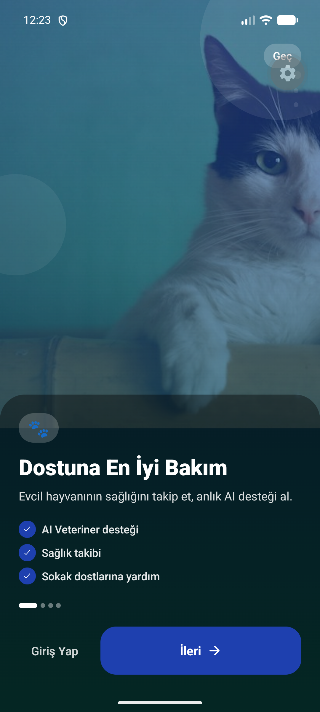
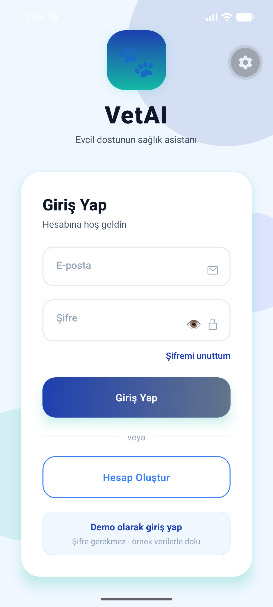
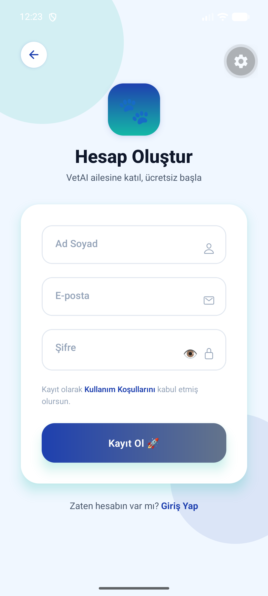
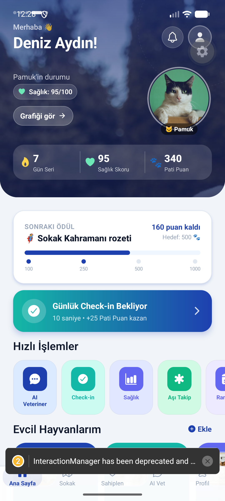
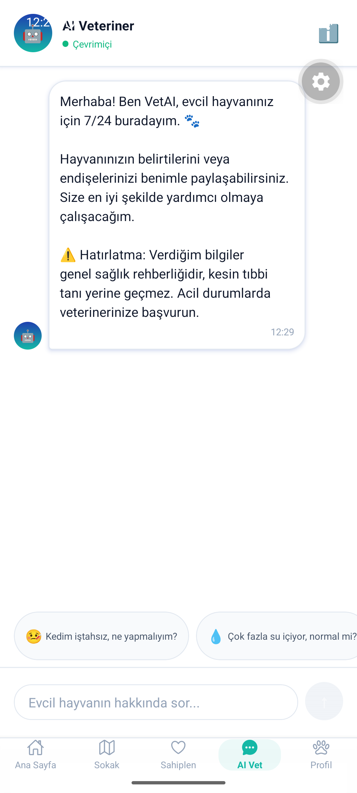
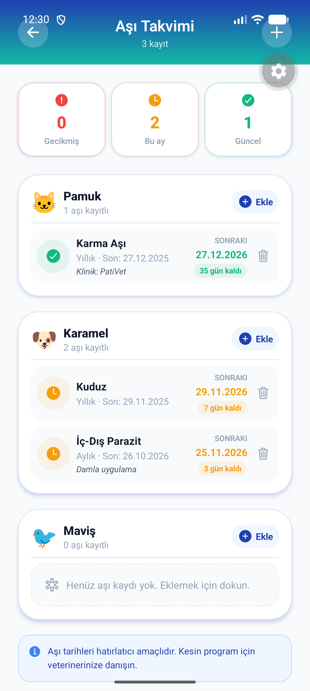
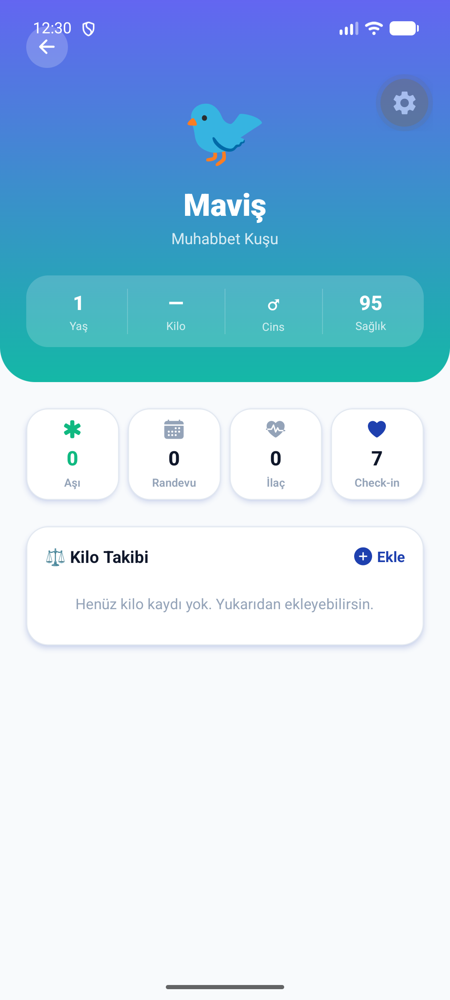
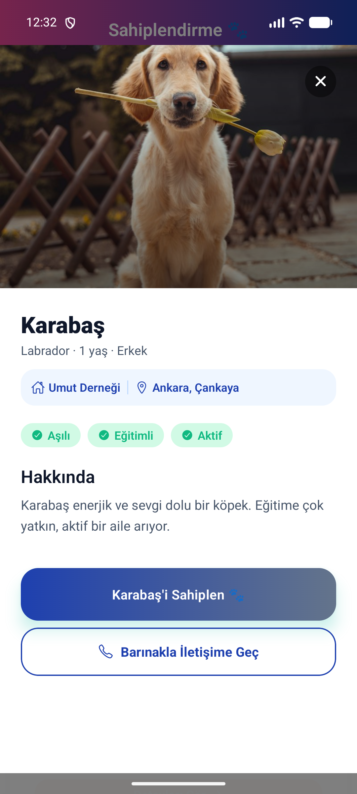
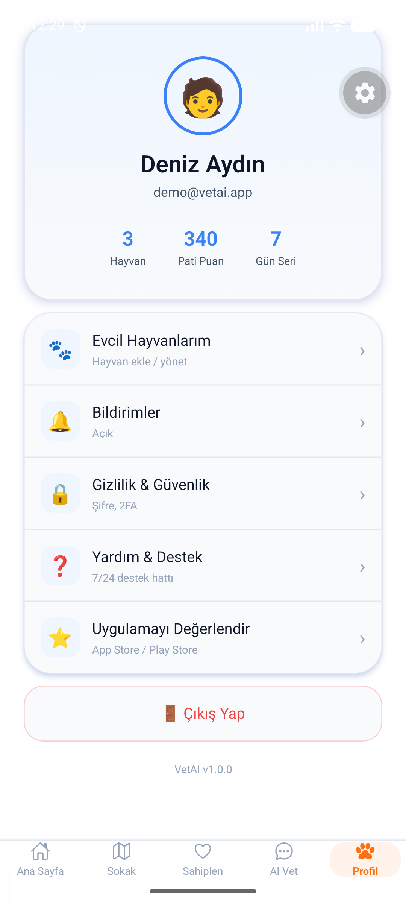

# 🐾 VetAI

**Yapay zekâ destekli evcil hayvan sağlık asistanı**

Sağlık takibi, aşı ve ilaç hatırlatıcıları, randevular, 7/24 AI veteriner sohbeti ve sokak hayvanlarına yardım — tek uygulamada.

*Bu repo uygulamanın tanıtım sayfasıdır. Kaynak kod şimdilik gizlidir.*

## 🎯 Amaç

Evcil hayvan sahipleri, hayvanlarının sağlığıyla ilgili küçük ama önemli şeyleri — aşı tarihleri, ilaç saatleri, kilo değişimi, iştah veya enerji düşüşü — çoğu zaman not etmez ve fark ettiklerinde iş geç kalmış olabilir. VetAI bunu çözmeyi hedefliyor:

1. **Erken fark etmek** — 10 saniyelik günlük check-in ile hayvanın su, iştah, enerji ve tüy durumunu kaydedip bir sağlık skoruna dönüştürmek; düşüşleri grafikte görünür kılmak.
2. **Hiçbir şeyi unutmamak** — aşı, ilaç ve veteriner randevularını tek bir hatırlatıcı ekranında toplamak; yaklaşan ve geciken kayıtları renklerle göstermek.
3. **Anında bilgi almak** — gece yarısı akla takılan "Bu normal mi?" sorusuna, hayvanın bilgilerini bilen Türkçe bir AI veteriner asistanıyla yanıt bulmak (veteriner muayenesinin yerine geçmeden).
4. **Sokak hayvanlarına yardım** — yardıma ihtiyacı olan sokak hayvanlarını haritada işaretlemek, sahiplendirme ilanlarını ve topluluk forumunu bir araya getirmek.
5. **Düzenli bakımı ödüllendirmek** — check-in serisi ve Pati Puan ile bakımı bir alışkanlığa dönüştürmek.

## 📸 Ekran Görüntüleri

*Android emülatöründe (Pixel 7) çalışan uygulamadan alınmıştır. Ekranlardaki kişi ve hayvanlar demo verisidir.*

| Karşılama | Giriş | Kayıt |
|:-:|:-:|:-:|
|  |  |  |
| İlk açılışta uygulamanın üç temel vaadi | E-posta ile giriş veya şifresiz demo modu | Hızlı hesap oluşturma |

| Ana Sayfa | AI Veteriner | Aşı Takvimi |
|:-:|:-:|:-:|
|  |  |  |
| Sağlık skoru, seri, Pati Puan, sonraki ödül ve hızlı işlemler | Hazır sorularla başlayan Türkçe AI sohbet | Geciken / bu ay / güncel aşılar, kalan gün sayısı |

| Hayvan Profili | Sahiplendirme | Profil |
|:-:|:-:|:-:|
|  |  |  |
| Aşı, randevu, ilaç, check-in özetleri ve kilo takibi | Sahiplendirme ilanı: sağlık durumu, barınak ve iletişim | Kullanıcı ve abonelik bilgileri |

## ✨ Özellikler

- **🤖 AI Veteriner** — Claude ile çalışan, hayvanın bilgilerini bilen Türkçe sohbet asistanı. Sunucuya ulaşılamazsa çevrimdışı moda geçer.
- **📊 Günlük Check-in & Sağlık Skoru** — su, iştah, enerji ve tüy soruları; haftalık grafik ve seri (streak) sistemi.
- **💉 Aşı / 💊 İlaç / 📅 Randevu** — her hayvan için ayrı kayıt, yaklaşan ve geciken hatırlatmalar.
- **⚖️ Kilo takibi & hayvan profili** — her hayvanın geçmişi ve özeti.
- **📷 Pati Günlüğü** — göz, deri, kulak etiketli fotoğraf günlüğü.
- **🗺️ Sokak Dostları haritası** — yardıma ihtiyacı olan sokak hayvanlarını konumla işaretleme.
- **🏠 Sahiplendirme & 💬 Forum** — topluluk ekranları.
- **🎁 Pati Puan & rozetler** — düzenli bakım için ödül sistemi.

## 🧱 Teknoloji

| Katman | Kullanılanlar |
|---|---|
| Mobil | React Native 0.85, Expo SDK 56, TypeScript, React Navigation, Zustand |
| Arayüz | Reanimated, Skia, Lottie, Linear Gradient, Chart Kit |
| Konum / Harita | expo-location, react-native-maps, Leaflet (web) |
| Sunucu | Node.js, Express, PostgreSQL (Sequelize), JWT + bcrypt |
| Veri | Supabase |
| Yapay zekâ | Anthropic Claude API |
| Kalite | ESLint, Jest birim testleri, TypeScript strict |

## 🛣️ Yol Haritası

- [x] Temel ekranlar (16+ ekran), demo modu
- [x] Aşı, ilaç ve randevu takibi
- [x] AI veteriner sohbeti
- [ ] Bildirimlerle gerçek zamanlı hatırlatmalar
- [ ] Fotoğraftan AI ön değerlendirme
- [ ] Veteriner klinikleriyle randevu entegrasyonu
- [ ] Mağaza yayını (Google Play)

## ⚠️ Not

VetAI genel bilgilendirme amaçlıdır; veteriner muayenesinin yerini tutmaz. Acil durumlarda veterinerinize başvurun.

Görseller: [Unsplash](https://unsplash.com) (Unsplash License).
